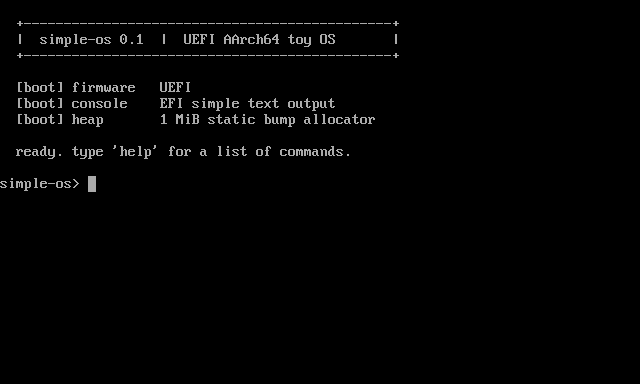

# simple-os

A tiny bare-metal AArch64 toy operating system with two boot paths:

- **QEMU `virt`** — a freestanding ELF kernel loaded by QEMU's `-kernel`, with
  its own PL011 console, GICv2 timer and exception vectors.
- **UEFI AArch64** — a single PE/COFF EFI application that boots on standard
  ARM64 UEFI firmware (and on QEMU with EDK2), with no external bootloader.



## Features

- **Two boot paths.** The QEMU kernel is a conventional bare-metal ELF; the
  UEFI build is one self-contained `BOOTAA64.EFI` file.
- **Real exception handling (QEMU).** A 2 KiB-aligned vector table covers all
  16 architectural entries. Synchronous faults print ESR, EC, ISS, FAR, ELR
  and SPSR with decoded fault classes before halting.
- **Interrupts (QEMU).** GICv2 plus the ARM generic timer, programmed for a
  100 Hz tick. `sleep` is driven by the timer interrupt.
- **PL011 serial console (QEMU).** A compact `printf` supports
  `%s %c %d %u %x %X %p %b`, width and zero padding.
- **UEFI console backend.** The UEFI build uses the firmware's text console,
  timer services and reset service, while sharing the same shell.
- **Interactive monitor.** Line editing, backspace, Ctrl-C, Ctrl-L, memory
  peek/poke, hexdumps, uptime, CPU information and more.
- **Native QEMU windows.** `make run` and `make run-efi` open dedicated QEMU
  windows; headless targets are available for SSH and CI.
- **Toolchain-light build.** Clang emits bare-metal AArch64 objects. The repo
  includes small Python linkers for ELF and PE/COFF, so no GNU cross-toolchain
  or external linker is required.

## Requirements

| Tool | Purpose |
| --- | --- |
| `clang` with the AArch64 target | Compiles C and assembly for `aarch64-none-elf` |
| `python3` | Runs the linkers and the smoke tests |
| `make` | Build orchestration |
| `qemu-system-aarch64` | Emulates the `virt` machine |
| AArch64 EDK2/AAVMF firmware | Only for `make run-efi` and `make test-efi` |

Upstream clang builds and the Xcode Command Line Tools both support the
required target. A GNU cross-compiler is not needed.

Typical installation commands:

```sh
# Debian / Ubuntu (qemu-system-arm contains qemu-system-aarch64)
sudo apt install clang make python3 qemu-system-arm qemu-efi-aarch64

# Fedora
sudo dnf install clang make python3 qemu-system-aarch64 edk2-aarch64

# Arch Linux
sudo pacman -S clang make python qemu-system-aarch64 edk2-aarch64

# macOS
xcode-select --install
brew install qemu
```

On Windows, use WSL2 with the Debian/Ubuntu instructions; QEMU should run
inside WSL.

### EDK2 firmware paths

The UEFI targets need an AArch64 EDK2/AAVMF code image and a writable variable
store. The Makefile detects common locations:

| Platform | Code | Vars |
| --- | --- | --- |
| macOS / Homebrew | `/opt/homebrew/share/qemu/edk2-aarch64-code.fd` | `/opt/homebrew/share/qemu/edk2-arm-vars.fd` |
| Debian / Ubuntu | `/usr/share/AAVMF/AAVMF_CODE.fd` | `/usr/share/AAVMF/AAVMF_VARS.fd` |
| Fedora | `/usr/share/edk2/aarch64/QEMU_EFI-pflash.raw` | `/usr/share/edk2/aarch64/vars-template-pflash.raw` |

If your distribution uses different filenames, override them:

```sh
make run-efi EDK2_CODE=/path/to/code.fd EDK2_VARS=/path/to/vars.fd
```

Use the non-Secure-Boot firmware variant: `BOOTAA64.EFI` is unsigned, so
Secure Boot will reject it unless you sign it yourself.

## Quick start

```sh
git clone https://github.com/xeronith/simple-os.git
cd simple-os

make            # QEMU virt kernel
make run        # native QEMU window

make efi        # UEFI AArch64 application
make run-efi    # UEFI under QEMU + EDK2

make test       # scripted QEMU virt test
make test-efi   # scripted UEFI test
```

SSH users can clone `git@github.com:xeronith/simple-os.git` instead.

`make run` opens a native QEMU window with the serial console as a virtual
terminal. Click the window and type as usual; close the window to quit. The
window shows the serial console, not a graphical framebuffer.

These targets need a graphical QEMU backend. Override the backend with
`QEMU_DISPLAY=gtk` (or `sdl`) if needed.

For terminal-only use:

```sh
make run-headless
make run-efi-headless
```

Press **Ctrl-A X** to quit a headless QEMU session.

`make run-efi` opens a UEFI VM window. On the first run EDK2 shows its boot
manager: press **Enter** once to select the UEFI device. The writable
`build/efi-vars.fd` normally remembers that choice; if the boot manager appears
again on a later run, press **Enter** to select the device. Delete
`build/efi-vars.fd` to start fresh.

### Build outputs

| Output | Description |
| --- | --- |
| `build/kernel.elf` | QEMU `virt` ELF kernel |
| `build/BOOTAA64.EFI` | UEFI AArch64 application |

## Shell commands

| Command | Description |
| --- | --- |
| `help` | List commands |
| `info` | CPU, timer, kernel and heap information |
| `uptime` | Time since boot, in ticks and seconds |
| `heap` | Bump-allocator usage |
| `alloc <bytes>` | Allocate memory from the bump heap |
| `mem <addr> [len]` | Hex dump (address and length in hex) |
| `peek <addr>` | Read a 64-bit word |
| `poke <addr> <val>` | Write a 64-bit word |
| `echo <text>` | Print text |
| `sleep <ms>` | Sleep using the platform timer |
| `clear` | Clear the screen |
| `panic` | Trigger a kernel panic |
| `reboot` | Reset the machine |
| `halt` | Stop the CPU |

`mem`, `peek` and `poke` use physical addresses and are not validated. On the
QEMU kernel a bad access produces a fault report; the UEFI build has no custom
exception handler, so avoid pointing them at arbitrary firmware memory.

## How it works

### QEMU `virt` target

QEMU jumps to `_start` at `0x40200000`. The first 2 MiB of RAM are left free
for QEMU's device tree and boot data. The boot path masks interrupts, drops
from EL2 to EL1 if necessary, installs the vector table in `VBAR_EL1`, sets up
a 16 KiB stack, clears `.bss`, and calls `kmain`.

```
0x40000000  RAM base (QEMU DTB / boot data)
0x40200000  kernel image and BSS
0x41000000  bump-allocator heap (16 MiB)
0x48000000  end of the default 128 MiB of RAM
```

The QEMU GICv2 is built without security extensions, so it behaves like a
single-security-state GICv1: `GICC_IAR`/`GICC_EOIR` are the acknowledge
registers and the timer uses PPI 30.

### UEFI AArch64 target

`make efi` builds a PE32+ EFI application. The UEFI entry point initializes
the firmware pointers, disables the watchdog, and runs the shared shell on top
of a small platform layer:

- `src/uefi/console.c` implements the `uart_*` API with the UEFI simple text
  output/input protocols and translates the shell's ANSI escapes.
- `src/uefi/timer.c` uses `BootServices->Stall` and `RuntimeServices->GetTime`.
- `src/uefi/heap.c` provides a 1 MiB static bump allocator.
- `src/uefi/main.c` handles reboot/halt and the EFI entry point.

The UEFI build currently runs as an EFI application: it uses firmware console,
timer and reset services, and does not exit boot services or install its own
exception vectors and interrupt controller yet. It is nevertheless a complete
bootable artifact for AArch64 UEFI machines.

### The linkers

Clang is a cross-compiler by construction: `--target=aarch64-none-elf` produces
ELF objects without needing a separate compiler installation. Linking them is
the only missing step on toolchains that do not ship a bare-metal linker.

- `tools/elflink.py` merges ELF sections and emits the one-segment QEMU kernel.
- `tools/peify.py` reuses the same ELF parser, splits code and data into PE
  `.text`/`.data` sections, records base relocations, and emits
  `BOOTAA64.EFI`.

Both tools report unsupported relocations rather than guessing. The PE image
is deliberately position-independent; the only absolute pointer is an anchor
that gives the loader a valid base-relocation table.

## Project layout

```
src/boot.S             QEMU entry point, EL2 -> EL1, stack and BSS setup
src/exc.S              vector table, IRQ save/restore, fatal fault path
src/kernel.c           QEMU banner, fault decoding, kmain
src/uart.c             PL011 driver and printf
src/timer.c            GICv2 and generic timer
src/shell.c            shared serial monitor
src/heap.c             QEMU bump allocator
src/lib.c              memset/memcpy/str* implementations
src/platform.h         platform hooks used by the shared shell
src/uefi/uefi.h        minimal UEFI ABI definitions
src/uefi/main.c        EFI entry point and platform services
src/uefi/console.c     UEFI text console backend
src/uefi/timer.c       UEFI timer backend
src/uefi/heap.c        UEFI static bump allocator
tools/elflink.py       minimal ELF64/AArch64 linker
tools/peify.py         ELF to PE32+ UEFI linker
tools/smoke-test.py    scripted QEMU virt test
tools/smoke-test-efi.py scripted EDK2/UEFI test
docs/uefi-window.png   screenshot of the UEFI build
Makefile               build, window, headless and test targets
```

## Booting on real hardware

`make efi` produces a single UEFI application. To boot a standard AArch64 UEFI
machine:

1. Format a USB stick as FAT32.
2. Copy `build/BOOTAA64.EFI` to `EFI/BOOT/BOOTAA64.EFI` on the stick.
3. Disable Secure Boot, or sign the image with your own keys.
4. Select the USB device in the firmware's boot menu.

The firmware on the machine is still required; “self-contained” here means the
repository produces the bootable artifact without a separate bootloader
installation. Apple Silicon Macs do not expose a generic UEFI boot path to
arbitrary operating systems, so use a standard ARM64 UEFI machine or the QEMU
+ EDK2 target.

The QEMU `virt` kernel is not portable to physical hardware: its UART, GIC,
RAM base and load address are tied to QEMU's machine model.

## Limitations

This is a toy kernel, not a production operating system:

- The QEMU build has the MMU and caches off; all addresses are physical.
- The UEFI build relies on the firmware's memory mappings and services.
- The UEFI build does not exit boot services or own interrupts yet.
- One CPU, no SMP.
- No user mode, no system calls.
- No preemptive scheduler or threads (the QEMU timer tick is ready for one).
- No block devices, filesystems or networking.
- The native window shows the serial console; there is no framebuffer or
  graphical desktop.
- `mem`, `peek` and `poke` trust the caller completely.

## Roadmap

Nothing below is implemented yet. This is the intended order of work, not a
release plan; later milestones depend on the earlier ones.

### Milestone 1 — leave the firmware behind (UEFI)

The current UEFI build is an EFI application: it calls `ConOut`, `ConIn`,
`Stall`, `GetTime` and `ResetSystem`, and lets the firmware own the machine.
The first real-kernel milestone is to change that:

- [ ] Call `ExitBootServices` with the final memory map key.
- [ ] Stop using Boot Services console, input, allocation and `Stall` calls.
- [ ] Build the kernel's own page tables and switch to an identity-mapped
      address space.
- [ ] Discover hardware from ACPI (`MADT`, `GTDT`, `SPCR`) or the device tree.
- [ ] Install the kernel's own exception vectors, GIC driver and generic timer.
- [ ] Bring up a native console: PL011, 16550, or a GOP/ramfb framebuffer.
- [ ] Keep only the runtime services that remain valid, such as `GetTime`,
      `ResetSystem` and UEFI variables; map them with `SetVirtualAddressMap`
      once the MMU is active.

**Why this order:** after `ExitBootServices` the firmware console, keyboard,
boot-time timer and memory allocator are gone. The kernel needs its own
interrupt controller, clock, console and page allocator before it can run the
shell again. Hardware discovery comes first so these drivers are not
hard-coded to one board.

This milestone also needs a GICv3 path, since many modern ARM64 machines do
not expose a GICv2 CPU interface.

### Milestone 2 — memory and scheduling (shared)

- [ ] MMU and caches on, with RAM and device mappings.
- [ ] Move to a higher-half kernel layout.
- [ ] Physical page allocator, kernel heap and guard pages.
- [ ] Timer-driven preemptive round-robin scheduler.
- [ ] Kernel threads with `yield`, `sleep` and `exit`.
- [ ] SMP bring-up using PSCI `CPU_ON`.
- [ ] Idle loop and per-CPU data.

### Milestone 3 — user mode and system calls

- [ ] Separate user and kernel page tables, with UXN/PXN enforced.
- [ ] EL0 tasks and an `svc` exception entry path.
- [ ] A minimal syscall table: `read`, `write`, `exit`, `yield`, `mmap`,
      `clone`.
- [ ] A small user-space shell or utility built as an ELF.

### Milestone 4 — devices and filesystems

- [ ] Virtio-mmio/PCI transport.
- [ ] Virtio-console or a persistent UART console.
- [ ] Virtio-blk and a read-only filesystem.
- [ ] Framebuffer console with a built-in 8×8 font.
- [ ] A boot image and an init process.

### Milestone 5 — real-hardware hardening

- [ ] Boot on at least two different AArch64 UEFI machines or boards.
- [ ] Support both ACPI and device-tree boot paths.
- [ ] SMP validation on physical hardware.
- [ ] Secure Boot signing instructions.
- [ ] A QEMU matrix covering GICv2, GICv3 and multiple firmware builds.
- [ ] Panic screens and persistent serial logs.

### Non-goals for now

POSIX compatibility, networking, a graphical desktop, and production security
are deliberately out of scope until the core kernel owns the machine.

## License

Released under the [MIT License](LICENSE).
